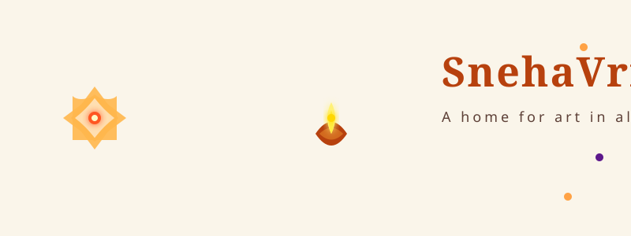
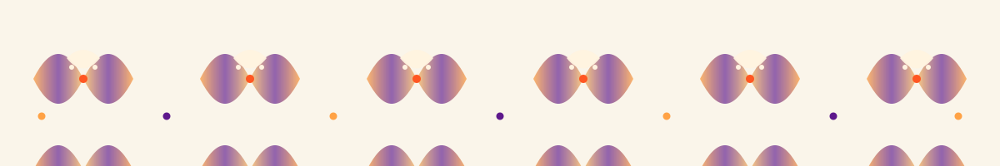
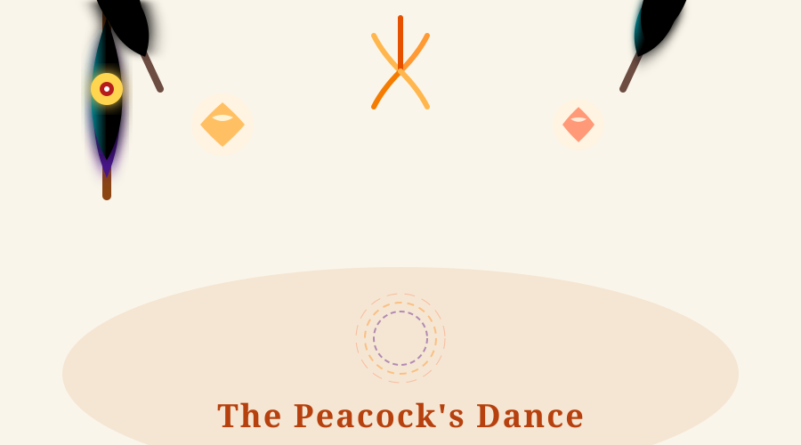
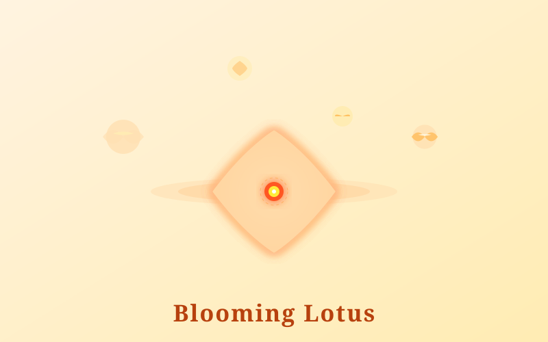
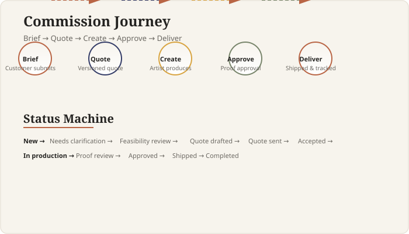
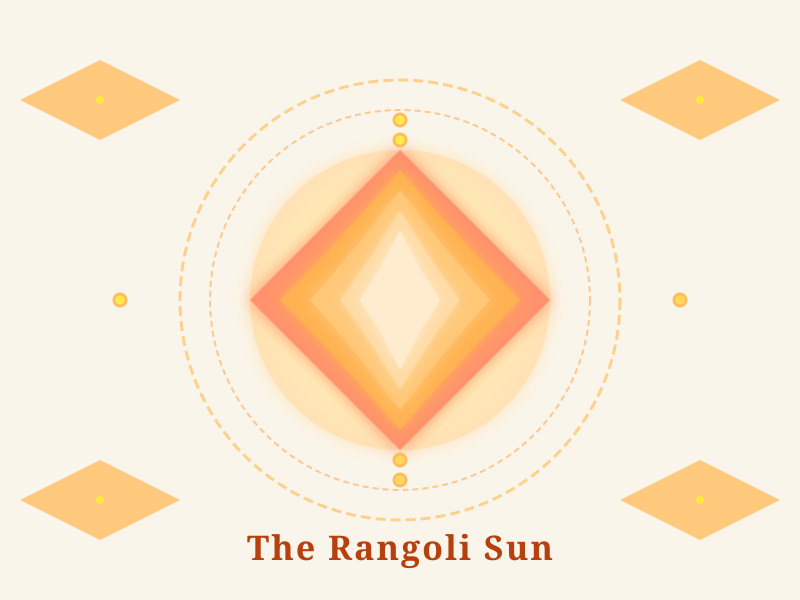

# SnehaVrinda Kala

<div align="center">
  
</div>

<div align="center">
  
</div>

---

<div align="center">

## 🪔 Every art has a place.

**SnehaVrinda Kala** — A home for art in all its forms — made, curated, personalized, and shared by creators.

Ready-to-ship artwork, handmade décor, made-to-order pieces, custom commissions, artist profiles, and creative kits — built on a custom **Next.js + Medusa v2 + Sanity** stack, rooted in Indian craft traditions and designed for a global audience.

> _Not a marketplace on day one. A curated, centrally managed creative brand with a real custom-commission workflow — brief → quote → create → approve → deliver._

</div>

<div align="center">
  
</div>

---

<div align="center">
  
</div>

---

## 🏛️ The Stack

<div align="center">

| Layer | Technology | Role |
|---|---|---|
| **Storefront & customer portal** | Next.js App Router + React + TypeScript | SEO-friendly website, product discovery, checkout, customer account |
| **Commerce backend** | Medusa v2 + Node.js + TypeScript | Products, variants, pricing, carts, orders, inventory |
| **Custom business backend** | Medusa custom modules, workflows, API routes | Artists, partners, commissions, milestones, payout ledger |
| **Database** | PostgreSQL | System-of-record |
| **Cache / workflow** | Redis | Caching, events, locks |
| **Editorial CMS** | Sanity (`1ifsr3lr` / `production`) | Journal, tutorials, artist stories |
| **Payments** | Razorpay | UPI / cards / net banking |
| **Shipping** | Shiprocket API | Courier, labels, tracking |
| **Hosting** | Vercel Pro + AWS ECS Fargate | Mumbai region (`ap-south-1`) |
| **IaC** | Terraform | Repeatable AWS infrastructure |
| **Package manager** | pnpm + Turborepo | Monorepo |

</div>

<div align="center">
  
</div>

---

## 📁 Repository Structure

```
snehavrinda-kala/
├── apps/
│   ├── storefront/   # Next.js public store & customer portal
│   ├── backend/      # Medusa v2 + custom business modules
│   └── studio/       # Sanity Studio (editorial)
├── packages/
│   ├── ui/           # Shared design system (terracotta · indigo · saffron)
│   ├── types/        # Shared API/domain types
│   └── config-*      # Lint / TypeScript / Tailwind config
├── assets/
│   └── images/       # Traditional Indian SVG illustrations
├── infra/
│   └── terraform/    # AWS Mumbai infrastructure
├── docs/
│   ├── adr/          # Architecture Decision Records
│   ├── operations/   # Runbooks
│   └── security/     # Security baseline
├── .github/workflows/# CI/CD pipelines
├── docker-compose.yml # Local dev stack
└── SnehaVrinda_Kala_Full_Build_Plan.md  # Full business blueprint
```

---

## 🚀 Getting Started

### Prerequisites
Node.js ≥ 20 · pnpm ≥ 12 · Docker & Docker Compose

### 1. Clone
```bash
git clone https://github.com/sainathsapa/snehavrindakala.git
cd snehavrindakala
```

### 2. Environment
```bash
cp .env.example .env
openssl rand -hex 32   # use one value for JWT_SECRET, one for COOKIE_SECRET
```
Fill in `JWT_SECRET`, `COOKIE_SECRET`, and the integration credentials you
need. Test keys first. The stack refuses to start in production when either
signing secret is missing.

### 3. Start the Local Stack
```bash
docker compose up -d
```
This brings up **PostgreSQL**, **Redis**, the **Medusa backend** (port 9000),
and the **Next.js storefront** (port 3000). The storefront image is built from
the existing backend/Medusa API; it does not bundle a second backend.

### 4. Prepare the Backend
The storefront assumes the existing Medusa schema. Sync link tables once
against the running database:
```bash
pnpm --filter @snehavrinda-kala/backend run links:sync
```
For a brand-new database, apply migrations first
(`pnpm --filter @snehavrinda-kala/backend run migrations:run`) and resolve any
pending custom-module migration issues before starting the API.

Create a region and a publishable API key in the Medusa admin
(`http://localhost:9000/app`), then set `MEDUSA_PUBLISHABLE_KEY` (and
optionally `MEDUSA_REGION_ID`) in `.env` and restart the storefront:

```bash
docker compose up -d --build storefront
```

Add products through the Medusa admin. The storefront reads catalogue, cart,
checkout details, artists, and commissions directly from the backend.

---

## 🎨 Design Tokens

<div align="center">
  
</div>

---

## 🧭 Core Flows

### Standard Product Order
1. Discover → add to cart
2. Medusa calculates cart, promotions, delivery
3. Razorpay payment session created
4. **Server-side verification** — order marked paid only after Razorpay callback confirmation
5. Shiprocket shipment created when dispatch-ready
6. Customer receives tracking

### Custom Commission (The Heart)
<div align="center">
  
</div>

Commission status machine:
`New → Needs clarification → Feasibility review → Awaiting artist/capacity → Quote drafted → Quote sent → Awaiting payment → Accepted → In production → Proof review → Approved → Ready to dispatch → Shipped → Completed`

---

## 🛠️ Development

| Command | What it does |
|---|---|
| `pnpm --filter @snehavrinda-kala/backend run typecheck` | Backend TypeScript check |
| `pnpm --filter @snehavrinda-kala/storefront run typecheck` | Storefront TypeScript check |
| `pnpm --filter @snehavrinda-kala/backend run test` | Backend unit tests |
| `pnpm --filter @snehavrinda-kala/storefront run build` | Storefront production build |

**Backend** (port 9000): `pnpm --filter @snehavrinda-kala/backend run dev`  
**Storefront** (port 3000): `pnpm --filter @snehavrinda-kala/storefront run dev`

---

## 🔐 Security

- JWT & cookie secrets configured (never committed)
- Razorpay webhooks validated via HMAC-SHA256 over raw body
- Integration event ledger for idempotent processing
- Private customer uploads in protected S3 with signed URLs
- Audit trail for price changes, refunds, payouts
- PostgreSQL & Redis in private subnets

---

## 🇮🇳 Launch Scope (Production)

- Custom Next.js storefront, mobile-responsive, SEO-optimized
- Medusa commerce backend/admin: products, inventory, carts, orders
- Sanity CMS for editorial content
- Razorpay payments with server verification
- Shiprocket shipping with tracking
- Custom commission request → quote → milestone → delivery workflow
- Partner application & artist profile foundation
- Role permissions, audit trail, transactional email
- Policies, privacy, GST/tax process, operational runbooks

---

## 📦 Deploy

### Local
```bash
docker compose up -d
```

### Production (AWS Mumbai)
Infrastructure defined in `infra/terraform/` — VPC, RDS Multi-AZ, ElastiCache, ECS Fargate, ALB, S3, CloudFront, Secrets Manager, CloudWatch.

CI/CD via GitHub Actions: lint → typecheck → test → build → deploy.

---

## 📚 Full Build Plan

The complete business, product, design, engineering, operations, security, and production-launch blueprint:

**`SnehaVrinda_Kala_Full_Build_Plan.md`**

---

<div align="center">
  
</div>

<div align="center">
  
</div>

<div align="center">
  <sub>Built with terracotta, indigo, and saffron. 🪔</sub>
</div>
