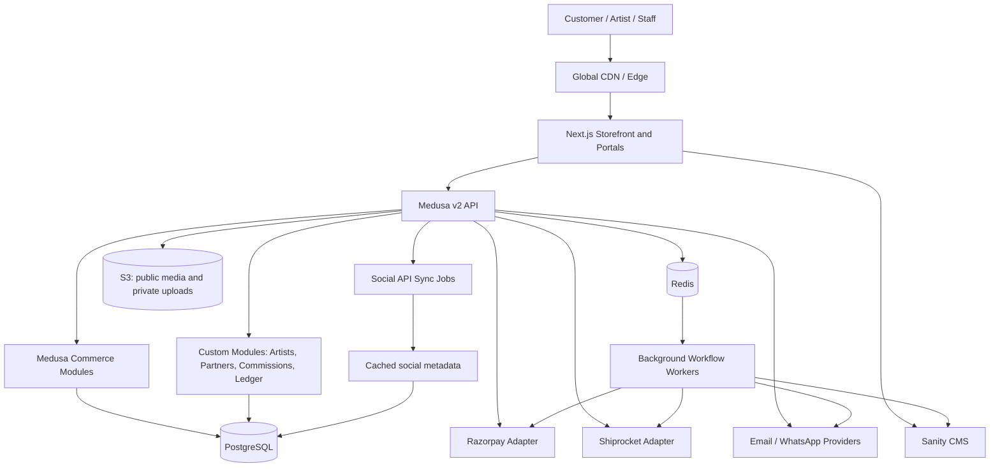

# SnehaVrinda Kala — Full Custom Platform Build Plan

**Document type:** Business, product, design, architecture, engineering, operations, security, and production-launch blueprint  
**Research checked:** 5 November 2026  
**Initial market assumption:** India-first, with Hyderabad as the working operating base; domestic fulfilment first and international sales after operational and tax validation  
**Brand:** SnehaVrinda Kala  
**Business model:** Art-first commerce brand with owned/curated products, custom commissions, artist partnerships, content, and a staged path to a multi-artist marketplace  
**Architecture decision:** Custom headless platform built on **Next.js + Medusa v2 + PostgreSQL**, with custom business modules and managed infrastructure  

> **Decision status:** This is the recommended target architecture and build blueprint. Before implementation, validate current supported versions, provider eligibility, fees, API permissions, and legal/tax treatment. Vendor documentation and commercial terms can change.

---

## 1. Executive recommendation

Build SnehaVrinda Kala as an **art-first creative-commerce platform**, not merely a catalogue website and not an unrestricted marketplace on day one.

The platform should support five connected business lines:

1. **Own-brand e-commerce:** Ready-to-ship artwork, handmade products, prints, décor, stationery, wearable art, kits, and other curated creative products.
2. **Made-to-order products:** Products with production lead times, personalization fields, and clear fulfilment promises.
3. **Custom commissions:** A structured process for briefs, reference uploads, feasibility review, quotations, deposits/milestones, proofs, production, delivery, and revisions.
4. **Artist and partner network:** Applications, verification, profiles, product submissions, agreements, capacity, quality review, order attribution, and partner earnings.
5. **Creative content and community:** Artist stories, art-form explainers, tutorials, videos, workshops, collaborations, and social updates.

The business should own its application code, business-specific data model, customer experience, integration logic, and deployment pipeline. It should **not** hand-write foundational commerce features such as carts, product variants, order management, pricing, inventory, and payment abstractions when a mature commerce framework already provides them.

### 1.1 Final technology decision

| Layer | Selected technology | Role |
|---|---|---|
| Storefront and customer portal | **Next.js App Router + React + TypeScript** | SEO-friendly website, product discovery, checkout journey, customer account, request tracking |
| Commerce backend | **Medusa v2 + Node.js + TypeScript** | Products, variants, pricing, carts, promotions, customers, orders, inventory, payment and fulfilment abstractions |
| Custom business backend | **Medusa custom modules, workflows, API routes, subscribers and admin extensions** | Artists, partners, commissions, approvals, production milestones, payout ledger, integrations |
| Database | **PostgreSQL** | System-of-record database for commerce and custom business data |
| Cache and background workflow infrastructure | **Redis** | Caching, event/workflow infrastructure, locks, and async work according to the Medusa deployment configuration |
| Editorial CMS | **Sanity** | Journal, tutorials, campaign pages, homepage content, editorial stories |
| Media/file storage | **Amazon S3 + CloudFront** | Product media, public assets, and protected customer reference uploads |
| Payments | **Razorpay**, through a Medusa payment-provider integration | UPI/cards/net banking and payment/refund lifecycle, subject to merchant approval and current provider terms |
| Shipping | **Shiprocket API**, through a custom fulfilment integration | Shipment creation, courier selection, labels, tracking, NDR and returns where supported by the account/API |
| Hosting | **Vercel Pro for Next.js storefront; AWS ECS Fargate for Medusa backend and workers** | Managed frontend deployment plus controlled backend infrastructure in India |
| Primary cloud region | **AWS Mumbai (`ap-south-1`)** | Backend, database, Redis, and media storage; compare Hyderabad region service availability and pricing before provisioning |
| CI/CD and source control | **GitHub + GitHub Actions** | Version control, tests, build, and controlled deployment |
| Infrastructure as code | **Terraform** | Repeatable AWS environments and infrastructure review |
| Monitoring | **Sentry + AWS CloudWatch** | Application errors, logs, metrics, alerts, and incident diagnosis |
| Analytics and search visibility | **GA4 + Google Search Console + Merchant Center** | Funnel, content, product discovery, and SEO measurement |

### 1.2 Why this architecture

This stack is selected because the business model includes workflows that go beyond conventional store operations:

- Each product may be connected to an artist, technique, material, collection, and production model.
- A custom request is not a normal product order; it has its own status, quote, attachments, deadlines, approvals, and milestones.
- Partner and artist records need access controls and operational workflows.
- A later marketplace may require vendor-specific product ownership, inventory, fulfilment, order splitting, refund allocation, and payout reconciliation.
- Editorial content and product commerce should be related but not forced into the same data model.

Medusa v2 provides modular commerce foundations and a framework for custom modules/workflows. Its marketplace recipe explicitly describes adding vendor data models, linking them to products/orders, protecting vendor API routes, splitting orders, and extending admin/vendor dashboards. This means marketplace functionality is **buildable**, not automatically delivered out of the box. See the [Medusa architecture](https://docs.medusajs.com/learn/introduction/architecture) and [marketplace recipe](https://docs.medusajs.com/resources/recipes/marketplace).

### 1.3 Why not Shopify as the foundation

Shopify remains a strong managed commerce product and would be the faster route for a conventional retail shop. It is not the chosen foundation for this plan because the long-term product includes first-class custom commissions, artist accounts, partner-specific operations, and marketplace logic that we want to own and shape.

| Decision factor | Shopify-first | Next.js + Medusa custom platform |
|---|---|---|
| Conventional catalog and checkout | Excellent, managed | Strong commerce foundation; integration and operational setup required |
| Business-specific commission workflow | Apps and custom extensions | Native custom module/workflow built for the business |
| Artist and partner portal | Additional apps/custom app | Custom authenticated portal and API |
| Vendor-specific logic | Depends on marketplace apps and constraints | Full control over data model and workflows |
| Database/business logic ownership | Platform-managed | Own application database and code |
| Routine content edits | Very easy in platform admin | Editors use Sanity; products use Medusa Admin |
| Infrastructure/maintenance | Lower | Higher; requires developer and cloud operations ownership |
| Long-term custom product experience | Platform-dependent | High flexibility |

**Important:** Custom is not automatically more scalable. Scaling depends on sound data modelling, indexes, caching, queue handling, cloud capacity, observability, testing, security, and experienced maintenance. The selected design reduces avoidable reinvention by using Medusa for core commerce and adding only the business-specific parts.

### 1.4 Architecture principles

- Start with a **modular monolith**, not microservices. Keep clear domain boundaries and split services only when measured load, team ownership, or release isolation justifies it.
- Medusa owns commerce records; custom modules own artist/partner/commission records; Sanity owns editorial content.
- PostgreSQL is the durable operational system of record. Redis is not the source of truth.
- Every integration has an adapter boundary, verified webhooks, retry handling, idempotency, logs, and reconciliation.
- Never trust a browser redirect as proof that a payment succeeded.
- Do not expose artist payout details or private customer reference uploads in public APIs.
- Keep the storefront fast and crawlable; social API availability must never be required to render a product or homepage.
- Build the launch business model first; enable open marketplace seller flows only after operational, legal, and tax approval.

---

## 2. Brand and product strategy

### 2.1 Proposed positioning

**Working positioning:** *A home for art in all its forms—made, curated, personalized, and shared by creators.*

Possible working brand line (not final copy): **“Every art has a place.”**

The brand can welcome a wide variety of art forms, but the shopping experience must be curated and structured. “Every art possible” is an ambition; it should not become an unfiltered catalogue. Use a clear taxonomy, strong product information, and a quality bar.

### 2.2 Customer groups

1. **Gift buyers:** Need occasion-led discovery, personalization, gift packaging, and delivery confidence.
2. **Art and décor buyers:** Need strong photography, dimensions, materials, provenance, care instructions, and trust in the maker.
3. **Commission customers:** Need a clear brief form, reference upload, budget range, timeline, quotation, and progress updates.
4. **Hobbyists and learners:** Need DIY kits, materials, tutorials, workshops, and beginner-friendly collections.
5. **Artists and craft partners:** Need a clear application, portfolio review, terms, product submission, work allocation, and payment process.
6. **Corporate/event buyers:** Need bulk gifting, custom artwork, workshops, event quantities, and quotation-based ordering.

### 2.3 Product and service types

| Type | Examples | Required operational information |
|---|---|---|
| Ready to ship | Original artwork in stock, prints, décor, stationery | SKU, stock, packed dimensions/weight, dispatch SLA |
| Made to order | Handmade décor, crochet, personalized gifts | Production lead time, capacity, personalization fields, cancellation rules |
| Custom commission | Portrait, mural, bespoke illustration, sculpture | Brief, reference files, quote, scope, milestones, approval records |
| Kit / learning product | DIY kit, craft kit, workshop kit | Contents, skill level, age guidance if relevant, instructions |
| Digital product (later) | Printables, patterns, downloadable workshop assets | File access, usage licence, refund/download policy |
| Workshop / experience (later) | Online or in-person class | Date/time, seat capacity, venue/link, attendance and cancellation rules |
| Corporate project | Bulk gifts, installations, custom event pieces | Buyer details, quantity, sample approvals, quotation, delivery schedule |

### 2.4 Initial category architecture

Start with a focused number of categories that have real supply, photography, pricing, and fulfilment readiness.

- **Painting & Drawing:** Original paintings, sketches, portraits, prints, illustration.
- **Traditional & Folk Art:** Region- and technique-led work with careful cultural attribution.
- **Home & Decorative Art:** Wall décor, sculpture, ceramics, lamps, decorative objects.
- **Textile & Fibre Art:** Embroidery, weaving, crochet, macramé, textile décor.
- **Paper, Stationery & Books:** Paper art, cards, journals, calligraphy, creative stationery.
- **Wearable Art:** Art jewellery, accessories, painted apparel, wearable craft.
- **DIY, Kits & Learning:** Starter kits, creative supplies, tutorials, workshops.
- **Personalized & Commissioned:** Custom gifts, portraits, event pieces, bespoke projects.

Navigation should support multiple discovery paths: **Shop by Art Form**, **Shop by Occasion**, **Shop by Artist**, **Shop by Material/Technique**, and **Custom Art**.

### 2.5 Differentiation

- Make the maker visible: artist profile, practice, materials, technique, and process.
- Treat custom requests as a real product journey, not a generic contact form.
- Explain what the customer is buying: materials, size, uniqueness, variation, lead time, care, and returns.
- Offer curated variety under one coherent brand system.
- Publish educational content that makes art easier to discover and appreciate.
- Establish fair partner terms, transparent attribution, quality standards, and predictable payout records.

---

## 3. Competitor research and website patterns

This is a qualitative review of public positioning, visible navigation, merchandising, and storytelling—not a private analytics audit, conversion-rate study, or complete page-by-page crawl. Revisit the sites before final design approval because catalogues and layouts change.

| Competitor/reference | Public emphasis | What to learn | How SnehaVrinda Kala can differentiate |
|---|---|---|---|
| [Zwende](https://www.zwende.com/) | Artist-made products, personalization, occasion-led gifting, named makers | Make personalization discoverable; show who designed or made a product; support recipient/occasion browsing | Broader art destination across fine art, craft, kits, commissions, and experiences; make custom request tracking central |
| [iTokri](https://itokri.com/) | Craft/handloom curation, artisan relationships, product availability, quality checks | Explain sourcing, stock status, quality checks, and the people behind objects | Maker stories across multiple art forms; distinguish in-stock, made-to-order, and commissioned work |
| [Okhai](https://okhai.org/) | Artisan empowerment, craft clusters, collaborative design, social impact | Explain the partner story and the value behind the product | Broader cross-medium work; make impact claims only where evidence exists |
| [Gaatha](https://gaatha.com/) and [Gaatha Shop](https://shop.gaatha.com/) | Craft documentation, research, artisan stories, films, shop | Educational content can create trust and organic search visibility | Bridge story → artist → product → workshop/custom request more directly |
| [Jaypore](https://www.jaypore.com/) | Curated artisanal products across apparel, jewellery, accessories, and home | Keep broad-category navigation understandable | Put art form and artist identity alongside conventional shopping categories |
| [Chumbak](https://www.chumbak.com/) | Distinct design-led lifestyle identity, seasonal collections, gifting | Brand identity and merchandising consistency matter | More maker-led and multi-disciplinary; do not let constant discounting define the brand |

### Competitive takeaways

1. Zwende is a useful reference for personalization and artist collaboration.
2. iTokri and Okhai show how provenance and maker stories can support product value and trust.
3. Gaatha demonstrates that educational content and commerce can reinforce each other.
4. Jaypore and Chumbak illustrate the value of clear category merchandising and a recognizable visual identity.
5. The opportunity is the combination of broad art discovery, a curated maker network, structured commissions, and dependable commerce operations.

---

## 4. Business model, seller model, and marketplace strategy

### 4.1 Launch model: centrally managed curated brand

Recommended launch model: SnehaVrinda Kala controls the customer experience, product approval, pricing rules, order support, and fulfilment promise. Artists/partners are onboarded through written agreements. The exact legal seller-of-record and invoicing arrangement must be set with a CA/lawyer before the first commercial sale.

Do not begin with unrestricted self-serve seller registration and automated split settlements. It adds complexity to product quality, refunds, consumer support, tax, seller verification, and fund flows before the operating model is proven.

Possible commercial structures to evaluate with an advisor:

- SnehaVrinda Kala buys/commissions products from an artist and resells them as the customer-facing seller.
- SnehaVrinda Kala manages a curated consignment/commission arrangement, with clearly defined seller and invoicing responsibilities.
- An independent artist is the seller and the platform facilitates the transaction—this can create a different e-commerce-operator, GST, and consumer-law analysis.

These are not interchangeable. Record the approved model for each partner/product type.

### 4.2 Marketplace stages

| Stage | Capability | Launch decision |
|---|---|---|
| Stage A | Brand-owned/curated catalogue, manual artist coordination, central customer support | Build for first production release |
| Stage B | Artist application, partner records, product submission, approval queue, commission work allocation | Build foundation at launch; automate only where useful |
| Stage C | Artist login, artist profile editing, product/order dashboard, availability and production capacity | Add after the first stable operating cycle |
| Stage D | Independent seller inventory/fulfilment, customer cart with multi-seller lines, vendor order splitting | Add only after legal and operational design review |
| Stage E | Automated partner transfers/payouts, seller analytics, disputes, marketplace policies | Add after Razorpay Route/other provider eligibility and accounting validation |

### 4.3 Commercial rules to document

For each partner/product type, define:

- Who is seller of record and who issues the tax invoice.
- Who sets the retail price and discount authority.
- Who owns inventory and absorbs damage/returns.
- Who confirms production capacity and dispatch date.
- Who handles customer complaints and refunds.
- Artist fee/wholesale price/commission calculation and payout timing.
- Rights to photographs, product descriptions, designs, and reproduction.
- Whether work is exclusive and where it may be sold.
- What happens to an open commission if the artist becomes unavailable.

---

## 5. Website experience and information architecture

### 5.1 Primary navigation

Recommended header:

- Shop
- Art Forms
- Artists
- Custom Art
- Workshops (show only once there is real inventory/events)
- Journal
- About
- Search, Account, Cart

On mobile, surface **Shop**, **Custom Art**, **Search**, and **Cart** prominently.

### 5.2 Page inventory

| Page | Purpose | Key sections/features |
|---|---|---|
| Home | Explain the brand and route customers into the site | Hero, art-form tiles, featured collection, custom CTA, artist spotlight, new arrivals, journal, videos/social links |
| All products | Browse complete catalogue | Filters, sort, product cards, availability labels |
| Collection pages | Search/category landing pages | Intro, filters, product grid, related art forms, useful FAQ |
| Product detail | Help customer buy confidently | Gallery, variants, price, stock/lead time, dimensions, materials, artist, shipping/returns/care, related pieces |
| Artist profile | Build trust and discovery | Bio, techniques, location where consented, portfolio, products, process story, commission status |
| Custom Art | Capture high-intent requests | Request form, reference upload, budget/timeline guidance, process, FAQs |
| Customer request status | Keep customers informed | Request reference, status, quote/approval, progress and contact path |
| Journal | Build organic discovery and brand depth | Tutorials, technique explainers, artist interviews, collection stories |
| Partner with us | Recruit/qualify artists | Expectations, selection criteria, benefits, application and portfolio upload |
| About | Brand credibility | Story, values, quality standards, curated partner approach |
| Contact / FAQ | Reduce support friction | Contact, order help, shipping, returns, payment, care, custom requests |
| Cart / checkout | Complete purchase | Summary, discount, delivery, tax, payment, clear policies |
| Customer account | Self-service | Order history, address book, shipment status, returns/support, saved requests |
| Policy pages | Transparency and compliance | Terms, privacy, shipping, returns/refunds, cancellation, partner policies |

### 5.3 Homepage sequence

1. One announcement strip with a real update or campaign.
2. Hero image, short brand promise, and two CTAs: “Explore Art” and “Request Custom Art.”
3. Six to eight visual art-form category tiles.
4. One featured collection with a clear editorial theme.
5. Custom creation explainer: brief → quote → create → approve → deliver.
6. Artist spotlight with portraits/process/product imagery.
7. New arrivals and bestsellers, clearly labelled.
8. Journal/tutorial/video content.
9. Reviews or customer work only with genuine permission.
10. Footer: contact, policies, newsletter, social accounts, business details.

### 5.4 Product detail page requirements

Every product page should answer:

- What is it? Use a clear title and plain-language description.
- Who made/designed it? Link to the artist profile.
- What is it made from? Describe medium, material, technique, finish.
- What size is it? Include dimensions and useful scale imagery.
- Is the pictured object the exact item or an example? Explain one-off work and natural handmade variation.
- Is it ready to ship or made to order? State a realistic dispatch/production estimate.
- Can it be personalized? Show fields, cost, proofing, and any extra lead time.
- How is it packed and shipped? Explain fragile/oversized handling.
- What are care instructions and return terms?

Use real photography: primary image, detail/texture images, in-context scale image, process image, and packaging image where relevant. Do not use stock images to represent handmade items.

---

## 6. Design system direction

### 6.1 Visual concept

**Direction:** Contemporary art gallery meets warm craft studio. The site should feel editorial, tactile, welcoming, and calm. Let artwork supply most of the colour; use interface colours for structure and recognition.

Avoid making every card, button, or section colourful. The storefront should not look like a crowded craft-fair poster.

### 6.2 Initial design tokens (exploration, not final brand identity)

| Token | Suggested value | Use |
|---|---|---|
| Paper / background | `#F7F4ED` | Warm page background |
| Surface | `#FFFFFF` | Cards, forms, overlays |
| Ink | `#242321` | Primary text |
| Muted ink | `#6B6862` | Secondary text |
| Terracotta | `#B96545` | Primary brand accent |
| Indigo | `#343C67` | Secondary accent for selected collections |
| Saffron | `#D8A441` | Small highlights only |
| Sage | `#78856B` | Supporting/natural accent |
| Border | `#E4DED3` | Dividers and outlines |

Typography prototype: an expressive serif such as **Cormorant Garamond** for editorial headings and a readable sans-serif such as **Manrope** for body, forms, filters, and commerce UI. Verify language/script coverage and font licensing before brand sign-off.

### 6.3 Frontend component system

Build reusable components in the storefront, with design tokens in CSS variables and Tailwind theme mapping:

- Header, desktop navigation, mobile navigation, footer, announcement strip.
- Buttons: primary, secondary, text, disabled, loading.
- Product card: default, sold out, made to order, customizable, new.
- Collection tile, artist tile, editorial card.
- Price block, variant selector, quantity selector, availability/lead-time label.
- Filter sidebar/drawer, sort control, search autocomplete, breadcrumbs.
- Image gallery, zoom, thumbnails, accessible video embed.
- Rating/review block, accordion, related products.
- Form fields, file upload, validation, upload progress, success state.
- Request timeline, quote summary, approval action, status label.
- Toast/notice, empty state, error state, skeleton loader.

### 6.4 Design rules

- Use a spacing scale in 4px increments.
- Meet WCAG 2.2 AA as the target for contrast, keyboard access, focus, and form semantics.
- Do not crop artwork in a way that changes the represented work; offer full-image viewing.
- Provide real hover, focus, active, loading, disabled, and error states.
- Treat mobile as the primary design validation environment.
- Never put essential product information only inside images.
- Use semantic HTML, headings in order, descriptive alt text, and accessible dialogs/drawers.

---

## 7. Final technology stack in detail

### 7.1 Selected stack

| Area | Technology | Build decision |
|---|---|---|
| Language | TypeScript | Strict mode for storefront and backend custom code |
| Frontend | Next.js App Router + React | Server Components by default; Client Components only for interactive UI |
| Styling | Tailwind CSS + CSS variables | Brand tokens and repeatable responsive styling |
| Component primitives | Radix UI primitives, with project-owned components | Accessible primitives; avoid a generic template look |
| Forms | React Hook Form + Zod | Typed client validation; revalidate on server |
| Commerce | Medusa v2 | Use its built-in commerce modules and workflows |
| Custom backend | Medusa modules, API routes, workflows and subscribers | Custom business domains live close to commerce transactions |
| Admin | Medusa Admin with custom widgets/UI routes | Internal operations interface; custom admin app only if the fixed admin becomes a real limitation |
| CMS | Sanity + official Next.js integration | Editorial content and campaign authoring |
| Database | PostgreSQL | Durable business records and transactions |
| Cache/workflows | Redis | Production workflow/event/cache providers compatible with Medusa |
| Search | Medusa Search Module with PostgreSQL provider initially | Upgrade to dedicated search only when relevance/facets/scale require it |
| Media | Amazon S3 + CloudFront | Public product media; private customer uploads in a separate protected bucket/prefix |
| Payments | Razorpay | Custom Medusa payment provider; verify current API and merchant eligibility |
| Marketplace transfers (later) | Razorpay Route, if approved | Linked accounts/transfers after legal, provider, and finance validation |
| Shipping | Shiprocket API | Custom Medusa fulfilment provider/integration adapter |
| Transactional email | Amazon SES or a vetted equivalent | Order/request events and delivery notifications |
| WhatsApp | Approved WhatsApp Business Platform provider | Later phase with consent, template, and opt-out handling |
| Analytics | GA4, Search Console, Merchant Center, Meta Pixel/CAPI | Consent-aware event collection and product feed |
| Monitoring | Sentry + CloudWatch | Errors, logs, dashboards, alerts |
| Hosting | Vercel Pro + AWS | Vercel frontend in Mumbai region; AWS backend/data services in Mumbai |
| CI/CD | GitHub Actions | Pull request validation and protected deployments |
| Infrastructure as code | Terraform | Versioned AWS infrastructure |
| Package management | pnpm workspaces + Turborepo | Monorepo dependency/build management |
| Testing | Vitest, Playwright, integration/contract tests | Unit, API, and end-to-end coverage |

### 7.2 What Medusa provides and what we must build

**Use Medusa for:**

- Products, product options/variants, prices, categories, collections, sales channels/regions where required.
- Carts, cart calculations, promotions, shipping options, payment sessions, customers, orders, inventory, fulfilment abstractions, refunds, and core commerce admin.
- Module boundaries, workflows, API routes, subscribers/events, authentication primitives, and admin extension points.

**Build as custom business modules:**

- Artists and artist users/roles.
- Partner applications, verification, agreements, and partner status.
- Artist-to-product and artist-to-order associations.
- Custom commission intake, quote, revisions, proofs, milestones, deadlines, and status.
- Product approval and quality-control records.
- Production capacity/availability and partner work allocation.
- Artist earnings, commission calculations, adjustments, payout ledger, and payout reconciliation.
- Vendor-specific views and permissions for the future marketplace.

**Do not build:** A custom payment vault, card-data handler, tax calculation engine without requirements, generic cart/order engine, or a separate product/inventory database that duplicates Medusa.

### 7.3 Version and dependency policy

- At project kickoff, select supported stable releases of Medusa v2, Next.js, React, Node.js LTS, PostgreSQL, Redis, and the Sanity SDK.
- Follow the version prerequisites in the Medusa starter documentation; its current starter guide documents a Node.js LTS prerequisite. Recheck before generating the repository.
- Pin dependencies with a committed lockfile; do not deploy floating `latest` dependencies.
- Review security advisories and dependency updates monthly, with a tested upgrade branch.
- Avoid alpha/beta APIs for checkout, payment, and other revenue-critical flows unless there is a written reason and fallback plan.

---

## 8. Target system architecture

### 8.1 Logical architecture



### 8.2 Request and data flow

- The browser loads the Next.js storefront through the CDN.
- Next.js fetches published product/category/customer-safe data from Medusa APIs and editorial content from Sanity.
- Customer checkout actions are sent to Medusa; Medusa creates and owns cart/order/payment records.
- Razorpay handles the payment instrument and returns provider references. Server-side verification and signed webhooks update payment state.
- Medusa workflows/subscribers trigger fulfilment and notification actions after the relevant order/payment state is verified.
- Shiprocket creates and tracks shipments; its webhook/API updates fulfilment state.
- Redis supports the production Medusa infrastructure modules and background work; PostgreSQL remains the source of truth.
- Public product media is served through CloudFront; private commission reference files are delivered only using authorized, short-lived access.

### 8.3 Application boundaries

Use separate deployable applications inside one repository:

- `storefront`: Next.js public site, customer account, commission request UI, artist portal route group.
- `backend`: Medusa v2 commerce server, custom modules, custom API routes, workflows, subscribers, payment/fulfilment providers, admin extensions.
- `studio`: Sanity Studio and editorial schemas (can be deployed through Sanity or mounted separately).
- `infra`: Terraform for AWS resources, IAM, networking, task definitions, secrets references, alarms, and DNS/CDN configuration.
- `packages/ui`: shared design components/tokens.
- `packages/types`: shared API/domain types where safe; do not duplicate Medusa internal models.
- `packages/config`: shared lint, TypeScript, and formatting configuration.

### 8.4 Modular monolith, not microservices

Keep the backend as one Medusa application with explicit modules and workflows. Separate the HTTP/API runtime from background workers as deployment processes if the chosen Medusa configuration supports it. Do not introduce service-to-service networking for every feature.

A future extraction should be triggered by evidence such as independent scaling requirements, separate team ownership, strict release isolation, or a measurable performance bottleneck—not by a desire to make the architecture look sophisticated.

---

## 9. Repository structure and development workflow

### 9.1 Suggested monorepo

```text
snehavrinda-kala/
├── apps/
│   ├── storefront/             # Next.js: public store, customer and artist portal
│   ├── backend/                # Medusa v2 server and custom modules
│   └── studio/                 # Sanity Studio (if not hosted separately)
├── packages/
│   ├── ui/                     # Shared design system/components
│   ├── types/                  # Shared API contracts/types
│   ├── config-eslint/
│   ├── config-typescript/
│   └── config-tailwind/
├── infra/
│   ├── terraform/
│   ├── environments/
│   └── runbooks/
├── docs/
│   ├── architecture/
│   ├── adr/                    # Architecture decision records
│   ├── design-system/
│   ├── operations/
│   ├── integrations/
│   ├── security/
│   └── launch/
├── scripts/
├── .github/workflows/
├── pnpm-workspace.yaml
├── turbo.json
└── README.md
```

### 9.2 Development standards

- TypeScript strict mode; no broad `any` without a documented reason.
- ESLint + Prettier and consistent import rules.
- Zod or equivalent runtime validation on all external input boundaries.
- API schemas documented and versioned; use generated OpenAPI where practical for custom endpoints.
- All database changes through reviewed migrations; never make production schema edits manually.
- All integration secrets in environment/secret storage, never in Git or browser bundles.
- Use feature branches and pull requests; protect `main` and production deployment approvals.
- Every business workflow should have an owner, state diagram, failure path, and audit trail.
- Record significant choices in Architecture Decision Records (ADRs).

### 9.3 Local development

Use Docker Compose for local PostgreSQL and Redis. Developers should be able to run the backend, storefront, and CMS preview with seeded sample data. Provide a safe `.env.example` containing variable names only, not real credentials.

Recommended local services:

- PostgreSQL database with migrations and seed data.
- Redis service.
- Medusa backend and Admin.
- Next.js storefront.
- Sanity local/staging project.
- Local test webhook tunnel or provider webhook simulator.

---

## 10. Data ownership and domain model

### 10.1 System-of-record map

| Data | Source of truth | Notes |
|---|---|---|
| Products, variants, SKUs, prices | Medusa | Do not maintain a second product database in Sanity |
| Stock and inventory movements | Medusa | Track inventory locations and adjustments |
| Carts, checkout, orders, refunds | Medusa | Commerce truth |
| Payment provider transaction state | Medusa payment records plus verified Razorpay references | Provider IDs and reconciliation data stored securely |
| Artists and partner operational status | Custom Medusa modules | Public profile data is exposed through controlled API |
| Commission requests and production milestones | Custom Medusa modules | Private by default; customer-facing projection only |
| Partner earnings/payout ledger | Custom Medusa module | Immutable ledger entries and reconciliation records |
| Editorial articles, tutorials, landing-page copy | Sanity | Refer to Medusa artist/product IDs rather than duplicate operational data |
| Product and editorial images | S3/CloudFront and/or Sanity asset CDN per content type | Do not store large binaries in PostgreSQL |
| Shipment IDs/status | Medusa fulfilment records + Shiprocket references/events | Keep provider ID and normalized internal state |
| Analytics events | GA4/analytics tooling | Analytics is not an operational source of truth |

### 10.2 Core custom records

Suggested initial model (final schema to be designed with migrations and Medusa module links):

| Entity | Important fields |
|---|---|
| Artist | `id`, display name, public slug, public bio, disciplines, techniques, region (only if consented), public links, portrait/media reference, status, commission availability |
| ArtistUser | Auth identity, artist association, role, status, MFA/verification metadata where supported |
| PartnerApplication | Applicant details, portfolio references, disciplines, pricing range, capacity, review status, reviewer, review notes |
| PartnerAgreement | Partner, agreement type, version, effective date, expiry/termination, commercial terms reference, signed-document reference |
| ProductArtistLink | Product ID, artist ID, attribution type, share/fee basis where private, primary artist flag |
| ProductApproval | Product, submitted version, reviewer, status, QC notes, approval time |
| CommissionRequest | Request ID, customer ID, art form, brief, intended use, dimensions, budget range, target date, delivery region/PIN, status, assigned artist |
| CommissionAttachment | Request ID, private object key, mime type, size, scan status, access policy, retention date |
| CommissionQuote | Request ID, version, scope, total, tax/fee breakdown, deposit/milestone rules, expiry, status |
| CommissionMilestone | Request ID, name, sequence, due date, status, proof/reference, approval state |
| CommissionRevision | Request ID, milestone, revision number, customer brief, artist response, approval record |
| PartnerCapacity | Artist, availability range, maximum active work, blackout dates, lead time |
| EarningsLedgerEntry | Partner, order/commission, gross basis, deductions, fee/share, adjustment, currency, state, audit metadata |
| PayoutBatch | Partner, period, line items, amount, provider reference, approved by, status, reconciled at |
| IntegrationEvent | Provider, event ID, event type, received time, signature result, processing state, attempt count |
| AuditRecord | Actor, role, action, entity, entity ID, before/after reference, timestamp, request correlation ID |

### 10.3 Data modelling rules

- Use Medusa module links to associate artists and partners with commerce entities rather than duplicating product/order tables.
- Use stable IDs/handles and immutable SKU rules.
- Keep customer-facing fields separate from private business fields.
- Store provider references and event IDs for reconciliation; do not store secrets or full payment credentials.
- Apply database constraints for unique external event IDs, commission references, SKUs, and payout references.
- Use soft deletion only where it supports legal/accounting retention; define retention and anonymization policies explicitly.
- Use audit records for manual price changes, refunds, partner assignments, commission quote changes, and payout approval.

### 10.4 Product attributes

Every listing should support fields such as:

- Art form, subcategory, technique, medium, materials, origin/region when verified.
- Artist attribution and collaboration credit.
- Dimensions, weight, packed dimensions, fragile/oversized flag.
- Stock type: `ready_to_ship`, `made_to_order`, `custom_only`, `digital` (if later).
- Production lead time and dispatch SLA.
- Personalization options, proof requirement, gift wrap, care instructions.
- Unique piece vs repeatable design, number of editions if limited.
- Shipping restrictions and return/cancellation rule reference.

---

## 11. Core customer and operations workflows

### 11.1 Standard product order

1. Customer discovers a product through search, collection, artist profile, journal, or social link.
2. Product detail shows price, variants, ready-to-ship/made-to-order status, stock/lead-time, materials, dimensions, maker, and policies.
3. Customer adds to cart and selects any allowed personalization.
4. Medusa calculates cart, promotions, delivery options, and payment session.
5. Backend creates the Razorpay payment order/session using the custom provider integration.
6. Customer completes payment through Razorpay's supported checkout flow.
7. Backend verifies the callback/signature and then reconciles the payment using provider API/webhook; do not use a frontend success redirect as the only confirmation.
8. Order enters the correct paid/processing state; inventory is reserved/decremented according to the chosen Medusa flow.
9. Fulfilment workflow prepares the Shiprocket request when the order is dispatch-ready.
10. Shipment label/AWB and tracking events are recorded; customer gets transactional updates.
11. Delivery, return, refund, and finance reconciliation are completed with audit records.

### 11.2 Custom commission request

1. Customer selects a commission category/art form.
2. Form captures description, intended use, medium preference, size, budget, target date, reference uploads, delivery PIN, contact details, and consent.
3. System generates a reference ID and confirmation.
4. Admin reviews completeness, feasibility, rights/permissions of reference files, schedule, and partner availability.
5. Admin assigns an artist or asks for clarification.
6. A versioned quote is prepared with scope, deliverables, dimensions, timeline, number of revisions, shipping, taxes/fees, deposit or milestone schedule, and expiry.
7. Customer accepts the quote and pays the requested amount through a Medusa order/payment flow.
8. Artist works against the agreed brief and milestone plan.
9. Proofs are uploaded privately; customer approves or requests an in-scope revision.
10. Final payment (if due) is collected; final item is quality checked, packed, shipped, and tracked.
11. Request/order is completed, artist earnings are reconciled, and customer may review the experience.

**Launch rule:** Quote and artist assignment remain human-reviewed. Do not automate quote generation until real data exists for artist rates, revisions, production time, packaging, and damage risk.

### 11.3 Commission status model

`New → Needs clarification → Feasibility review → Awaiting artist/capacity → Quote drafted → Quote sent → Awaiting payment → Accepted → In production → Proof review → Approved → Ready to dispatch → Shipped → Completed`

Additional terminal/interruption statuses: `Declined`, `Cancelled`, `On hold`, `Expired`, `Refund pending`, `Refunded`, `Disputed`.

The customer should see a simplified safe status. Internal notes, partner prices, private files, and payment/payout comments must never be shown publicly.

### 11.4 Artist/partner onboarding

1. Applicant submits contact, portfolio, disciplines, location, materials, product samples, pricing range, production times, capacity, packaging ability, and references.
2. Admin reviews originality, quality, communication, fulfilment, safety/material claims, and brand fit.
3. Team confirms seller/contract model, pricing method, IP/image licence, cancellations, defect handling, shipping, returns, and payout terms.
4. Agreement is reviewed/signed and a restricted artist record is activated.
5. Artist profile is prepared; only approved public fields are published.
6. First product(s) are reviewed, sample-ordered/tested where appropriate, and approved.
7. Partner receives clear order/commission instructions and the channel for operational communication.

### 11.5 Artist portal (later controlled release)

Artist portal capabilities should include:

- Artist profile and public portfolio editing (subject to approval).
- Product submission and status tracking; not instant publication.
- Availability, lead time, active commissions, and blackout dates.
- Assigned work, deliverable dates, proof upload, and completion checklist.
- Order/commission status and fee/earnings statements.
- Agreement and policy access.

Artists must not see other artists' customer records, payment references, internal margins, or platform-wide analytics. Enforce authorization server-side on every route and record access.

### 11.6 Returns, refunds, and disputes

Define separate paths for:

- Standard ready-to-ship products.
- Made-to-order products.
- Personalized goods.
- Custom commissioned work at each milestone.
- Damaged/incorrect goods.
- Undelivered, lost, or RTO shipments.

Policies should be understandable before purchase. Refund approval, payment refund request, partner earnings reversal, shipment return, and accounting reconciliation should be linked but distinct state transitions.

---

## 12. Integration architecture

### 12.1 Integration design rules

- Each third party is connected through a provider/adapter module, not scattered API calls throughout business code.
- Webhook endpoints validate signature/authenticity before processing.
- Use idempotency keys or a unique event ledger to make duplicate events safe.
- Respond to provider webhooks quickly; enqueue longer work and process asynchronously.
- Store provider references, normalized state, timestamp, and redacted diagnostic payloads.
- Retry transient failures with exponential backoff and a maximum attempt policy.
- Provide an admin reconciliation screen for missed/failed events.
- Alert on stuck payments, shipment failures, repeated webhook errors, and payout discrepancies.

### 12.2 Razorpay payments

**Selected approach:** Implement and test a Medusa Payment Module Provider that maps Medusa payment lifecycle methods to Razorpay APIs. Confirm the provider API version and merchant eligibility before committing to the implementation.

Required capabilities:

- Create a provider payment order/session for a Medusa cart/order.
- Open Razorpay's supported checkout UI without collecting/storing raw card credentials in SnehaVrinda Kala systems.
- Verify payment callback signatures server-side.
- Verify provider payment state with authenticated API calls where needed.
- Receive payment, failure, refund, and dispute-related webhooks as applicable.
- Support full and partial refunds if the payment provider/business rules allow them.
- Reconcile captured amount, currency, provider ID, Medusa order, refunds, fees, and settlement references.

**Webhook controls:** Razorpay documentation states webhook signatures are sent in the `X-Razorpay-Signature` header and are calculated using HMAC-SHA256 over the raw request body. Validate the raw body before JSON normalization, store the provider event ID, and make processing idempotent. Test the webhook in staging before enabling live events.

**Important payment rule:** A successful browser redirect is not payment proof. Mark the order paid only after valid server-side verification/provider state confirmation. Handle out-of-order and duplicate webhook events safely.

### 12.3 Artist payouts and Razorpay Route (future phase)

Razorpay Route supports linked accounts and transfers to multiple recipients. It is a candidate for later artist settlements, not a launch assumption.

Before activating it:

- Obtain written confirmation of platform/merchant eligibility and required account onboarding.
- Confirm the legal seller-of-record and marketplace structure with CA/legal counsel.
- Decide if transfers happen at order capture, dispatch, delivery, or after return window.
- Model refunds, transfer reversals, partial refunds, failed transfers, holds, and settlement reconciliation.
- Maintain an internal earnings ledger independent of the payment provider so finance can reconcile what should be paid against what actually transferred.
- Do not store bank-account credentials in the custom platform unless necessary and legally/contractually approved; prefer provider-managed onboarding where available.

### 12.4 Shiprocket shipping

Because the storefront is custom, use Shiprocket's API directly through a Medusa fulfilment integration rather than relying on a Shopify channel integration.

The API documentation covers order creation, courier selection, shipments, labels/manifests/invoices, tracking, pickup addresses, NDR, and return/exchange workflows. Validate which endpoints/features are available for the actual account and plan.

Build the integration in stages:

**Stage 1 — Essential shipping**

- Validate pickup address, GST/invoice data, serviceability, package weight/dimensions, and product restrictions.
- Create a Shiprocket order/shipment for each dispatch-ready Medusa fulfilment.
- Get courier/AWB and label; save the normalized result in Medusa.
- Support shipment cancellation and pickup scheduling.
- Receive tracking/status updates through webhooks or controlled polling.
- Send tracking to the customer.

**Stage 2 — Operations automation**

- NDR triage and customer confirmation.
- Return pickup and RTO workflow.
- Multi-package/partial fulfilment where supported.
- Artist pickup locations and partner-specific dispatch only after Shiprocket confirms account/setup support.
- Admin exceptions dashboard and reconciliation of freight/COD charges.

**Packaging controls:** Define standards by media/material: paper, canvas, framed art, ceramic, glass, sculpture, textiles, and oversized items. Test sample shipments. Set COD eligibility and RTO limits only after understanding cost and risk.

### 12.5 Sanity CMS

Use Sanity for:

- Homepage and campaign sections.
- Journal articles, artist interviews, technique explainers, and tutorials.
- Static information pages and FAQs.
- Video/playlist references and curated social-update blocks.
- Editorial collection pages and seasonal storytelling.

Do not make Sanity the product or inventory system. Product price/stock/order fields remain in Medusa. Public artist operational identity lives in the Artist module; Sanity stories should refer to the artist ID so editorial copy does not become a competing source of truth.

Use draft/preview for editorial review and webhook-based revalidation to update Next.js pages after publishing.

### 12.6 Instagram / Meta

- Use official Meta developer APIs, catalog integrations, and approved embeds only.
- Confirm eligible professional account type, permissions, business assets, review requirements, and regional availability at implementation time.
- For launch, link the profiles and curate selected posts/reels as editorial blocks.
- Later, schedule API sync of approved public media metadata, cache it, and display cached cards.
- Do not scrape pages or depend on undocumented endpoints.
- Store product/catalog metadata in Medusa; the social catalog is a downstream channel, not a second product database.

### 12.7 YouTube

- Launch with official embeds and curated playlists.
- Later, use the YouTube Data API to read the brand channel's uploads playlist and refresh cached video metadata on a schedule.
- Follow API quota rules; do not call the API on every homepage request.
- If the API is unavailable, keep cached videos or CMS-curated links visible.

### 12.8 X (formerly Twitter)

- Launch with a profile link and optionally a small number of official post embeds.
- Treat API access and pricing/limits as variable; verify current access before budgeting an automated feed.
- Do not make homepage rendering depend on X API availability.
- Re-publish important updates in the website Journal/Updates section so the brand retains searchable, accessible content.

### 12.9 Social publishing and website updates

Use the website CMS as the durable editorial record. Recommended workflow:

1. Editor writes an update/story in Sanity.
2. Editor adds related products, artists, or a YouTube/video reference.
3. Content is reviewed and published on the website.
4. Team shares the website URL on Instagram/YouTube/X through each platform's supported publishing tools.
5. Where API terms permit, store post URLs/IDs and sync selected media metadata back to the website cache.

Do not assume a post published on one social platform can be automatically reposted to all others. Each platform has distinct permissions, formats, and commercial rules.

### 12.10 Email and WhatsApp

- Transactional email for order confirmation, payment, shipment, custom request, quote, milestone, refund, and support updates.
- Use a verified domain with SPF, DKIM, and DMARC.
- Marketing newsletter consent must be separate from transactional communication.
- WhatsApp Business messaging must use an approved provider and respect opt-in, templates, business-initiated conversation rules, and opt-out handling.
- Keep notification preferences and consent history auditable.

### 12.11 Accounting and tax integrations

- Choose accounting software with the CA before launch (for example, Zoho Books or TallyPrime—select one, not both as competing books).
- Create a daily/weekly reconciliation of Medusa orders, Razorpay captures/fees/refunds, Shiprocket freight/COD, tax, and partner settlements.
- Preserve invoice numbers and credit-note/refund references in finance records.
- Do not assume a payout equals an expense or a transfer equals the final tax/accounting treatment.

---

## 13. SEO, content, performance, and discovery

SEO is an engineering and editorial requirement from day one. No framework guarantees rankings; useful unique pages, crawlability, performance, and credible content matter.

### 13.1 Next.js SEO implementation

- Use server-rendered or statically generated product, collection, artist, and editorial pages where appropriate.
- Generate unique metadata, canonical URLs, Open Graph/Twitter metadata, and social share images.
- Use stable URLs such as `/collections/folk-art`, `/products/hand-painted-terracotta-vase`, `/artists/artist-slug`, `/custom-art`, `/journal/article-slug`.
- Add XML sitemap, robots rules, canonical policy, breadcrumbs, and redirects.
- Add JSON-LD for Product/Offer, BreadcrumbList, Organization, Article, and other appropriate types; keep schema values consistent with visible content.
- Include product price, availability, SKU, shipping and return information accurately where supported.
- Avoid indexing empty, duplicate, filtered/sorted, or near-duplicate pages.
- Keep filter states usable without generating unlimited crawlable URL combinations.
- Use descriptive filenames, responsive images, modern formats, and alt text that describes the image without keyword stuffing.
- Submit sitemap and monitor coverage/indexing in Search Console.

Next.js provides `metadata` and `generateMetadata` APIs for page metadata and social sharing. See the [Next.js metadata documentation](https://nextjs.org/docs/app/getting-started/metadata-and-og-images) and [Google's ecommerce SEO guidance](https://developers.google.com/search/docs/specialty/ecommerce).

### 13.2 Content pillars

1. Art-form explainers: what the art is, history/context when verified, technique, materials, and care.
2. Artist stories: practice, inspiration, process, available pieces, and commission options.
3. Technique/process: tutorials, short videos, behind-the-scenes, and material explainers.
4. Product/collection edits: gifts, home styling, seasonal collections, and themed curation.
5. Custom-work guidance: how to brief an artist, timeline, revisions, budget drivers, and examples.
6. Workshops/community: events, kits, learning resources, and collaborations.

### 13.3 Analytics events

Define and test events for:

- `view_item_list`, `select_item`, `view_item`, `search`, `filter_applied`.
- `add_to_cart`, `remove_from_cart`, `begin_checkout`, `add_payment_info`, `purchase`.
- `commission_started`, `commission_submitted`, `quote_accepted`, `commission_approved`.
- `artist_application_started`, `artist_application_submitted`.
- `newsletter_opt_in`, `contact_click`, `whatsapp_click`, `video_play`.

Do not send sensitive request descriptions, reference files, personal information, or payout values to general analytics tools.

### 13.4 Performance targets

Set measurable production budgets at design/build time and verify them with field data:

- Good Core Web Vitals on important mobile routes.
- Fast first render for product and collection pages.
- Responsive image sizing and lazy loading below the fold.
- Minimal client-side JavaScript; server components by default.
- Cache public catalogue/editorial responses appropriately; bypass cache for account, cart, checkout, and private request data.
- Avoid third-party social widgets that block rendering.

---

## 14. Admin, customer, and artist experiences

### 14.1 Internal admin

Use Medusa Admin for commerce operations, extended with custom widgets and UI routes for:

- Artist/partner overview and verification state.
- Commission request queue and assignment.
- Quote and milestone management.
- Product approval/QC queue.
- Earnings ledger and payout reconciliation.
- Integration exception inbox for Razorpay and Shiprocket events.

Medusa Admin supports custom widgets and UI routes, but there are limits to changing the core layout. If workflow requirements outgrow it, create a separate operations console using Medusa Admin APIs rather than distorting the core Admin.

### 14.2 Customer account

- Register/login and account security.
- Order history and shipment tracking.
- Addresses and contact preferences.
- Commission request list and customer-safe status.
- Quote acceptance/payment and proof approvals.
- Support/refund request channel.

### 14.3 Artist portal

Build after the core store is stable, but design the roles/data model now. Use separate artist authentication/actor permissions; do not give artists internal Medusa Admin credentials.

### 14.4 Role permissions

Define roles such as Owner, Commerce Admin, Catalog Editor, Operations, Commission Manager, Finance, Artist Coordinator, Support, and Artist User. Enforce authorization server-side and test cross-tenant access. Staff MFA should be mandatory for privileged access.

---

## 15. Security, privacy, legal, and trust requirements

This is a technical and planning checklist, **not legal or tax advice**. Have an India-qualified CA and lawyer review the actual product, payment, seller, and partner model.

### 15.1 Consumer e-commerce compliance

- Publish accurate legal business name, address/contact information, customer support details, and grievance details as applicable.
- Publish understandable terms, privacy, shipping, cancellation, return/refund, and custom-order policies.
- Explain made-to-order and personalized product cancellation/return conditions before payment.
- Show accurate product details, price/tax treatment, origin declarations where required, and delivery estimates.
- Provide a documented customer grievance intake and resolution workflow.
- Review the Consumer Protection (E-Commerce) Rules, 2020 and the 2026 amendment. The Department of Consumer Affairs/PIB announcement says the 2026 amendment is to come into force on **1 January 2027**; review the final Gazette text with counsel before that date.

### 15.2 GST and marketplace model

CBIC's GST sectoral FAQ distinguishes own-account sales from cases where supplies are made by other suppliers through an electronic commerce operator. The exact applicability of GST registration, TCS, invoicing, and other obligations depends on the actual transaction structure and current law.

Before independent artist sellers are allowed to transact, obtain a written CA view on:

- Who is the seller of record for each sale?
- Who issues the customer invoice and handles tax/credit notes?
- Is SnehaVrinda Kala selling its own inventory or facilitating sales by another supplier?
- Does the flow trigger electronic-commerce-operator registration/TCS or other reporting?
- How do commissions, refunds, payouts, and returns affect accounting?

Do not activate marketplace payouts based only on a marketplace plugin or a generic online article.

### 15.3 DPDP Act and Rules readiness

The Digital Personal Data Protection Act, 2023 and Digital Personal Data Protection Rules, 2025 have phased commencement provisions. The official November 2025 notifications set different commencement dates for different sections/rules. The main notice/consent and many substantive duties have an 18-month timetable from publication in November 2025; certain provisions have earlier commencement dates. Have counsel map the applicable dates and obligations to the actual launch and data flows.

Build privacy readiness now:

- Collect only information needed for the requested transaction/service.
- Provide standalone, clear privacy notices that explain purpose and data categories.
- Separate transactional communications from optional marketing consent.
- Maintain consent records and an easy opt-out/withdrawal path where required.
- Define access, correction, deletion, grievance, and retention workflows.
- Limit access to customer reference images, addresses, phone numbers, and artist payout records.
- Use processor/vendor contracts and review data flows to external tools.
- Define incident response and breach assessment procedures.

### 15.4 Artist rights and intellectual property

Partner terms should cover:

- Ownership of original artwork/designs.
- Licence to photograph, display, advertise, and sell the work.
- Exclusivity, territory, duration, and termination.
- Artist credit and attribution requirements.
- Commission rights and whether customer receives personal-use or broader rights.
- Permission for prints, derivatives, merchandise, and promotional reuse.
- Customer confirmation that submitted references/photos may be used for the requested commission.
- Takedown workflow for suspected infringement.

### 15.5 Application security baseline

- Enforce MFA for privileged users and protect admin accounts.
- Use least-privilege IAM roles for ECS tasks, build jobs, and staff.
- Keep PostgreSQL and Redis in private subnets; do not expose database ports publicly.
- Use HTTPS, WAF/rate limiting, secure headers, and input validation.
- Store secrets in AWS Secrets Manager or a suitable secure secret store.
- Do not place API secrets in browser code, source control, logs, or CMS content.
- Verify webhook signatures using raw request bodies where provider requires it.
- Protect file upload endpoints: type/size limits, generated object keys, malware scanning, private access, and retention.
- Encrypt data at rest and in transit; define key rotation and backup controls.
- Patch dependencies and base images; scan containers and dependencies.
- Record security-sensitive admin operations in an audit log.
- Run periodic access review and restore tests.

---

## 16. Hosting, infrastructure, reliability, and scalability

### 16.1 Hosting choice

**Recommended deployment split:**

- Next.js storefront/customer/artist frontend on **Vercel Pro**, with runtime functions configured to the Mumbai region (`bom1`) where applicable, close to the AWS Mumbai backend.
- Medusa API/Admin and background workers on **AWS ECS Fargate** in `ap-south-1` (Mumbai), behind an Application Load Balancer.
- PostgreSQL on Amazon RDS for PostgreSQL.
- Redis on Amazon ElastiCache.
- Product/public assets and protected uploads in S3; public assets served through CloudFront.

Vercel documents Mumbai (`bom1`) as a compute region and recommends placing functions near data sources. Medusa's deployment guide documents separate deployment of the server/Admin and storefront, and supports Vercel for the storefront. Use a commercial Vercel plan for a commercial site; do not build a business production deployment on a free/personal-only plan.

### 16.2 AWS components

| Component | Recommended service | Notes |
|---|---|---|
| API/worker compute | ECS Fargate | Dockerized Medusa tasks; separate API and worker service/process where appropriate |
| HTTP entry | Application Load Balancer | TLS termination/routing to backend tasks; restrict admin exposure where possible |
| Database | RDS PostgreSQL | Private subnets, automated backups, encryption, Multi-AZ for production availability |
| Cache/workflow | ElastiCache Redis | Use production Medusa providers and managed Redis configuration |
| Object storage | S3 | Separate public assets and private commission/customer uploads |
| CDN | CloudFront | Public images/assets; signed/private access patterns for protected files |
| Secrets | Secrets Manager / Parameter Store | Keep secrets out of images and GitHub logs |
| Monitoring | CloudWatch | Logs, metrics, dashboards, alarms |
| Network protection | WAF, security groups, private subnets | Rate limits, edge protection, database isolation |
| DNS/certificates | Route 53 / ACM or chosen equivalent | HTTPS and controlled DNS |
| Infrastructure | Terraform | Reproducible environments and reviewed changes |

**Region selection:** Mumbai (`ap-south-1`) is the baseline because it is an established India region. AWS also lists Hyderabad (`ap-south-2`). Before provisioning, verify that every required service, instance class, Redis engine option, quota, and managed feature is available in the selected region and compare total cost/latency. Keep the region as infrastructure configuration, not hard-coded application logic.

### 16.3 Environments

Maintain separate `development`, `staging`, and `production` environments.

- Development: local Docker services and test provider keys.
- Staging: production-like service versions, separate database/bucket/Redis, test payment/shipping accounts, seeded fake data.
- Production: live keys, restricted access, backups, alerting, and approval-gated releases.

Never copy production customer files into staging unless properly anonymized and approved.

### 16.4 Availability and recovery

- Production RDS should use Multi-AZ when order/payment reliability justifies it. Multi-AZ improves availability/failover; it is not a read-scaling solution.
- Enable automated backups and point-in-time recovery; define retention with finance/legal needs.
- Use at least two backend tasks across Availability Zones for a high-availability production configuration when budget and workload justify it.
- Configure ECS service autoscaling based on CPU/memory/request/queue indicators after load testing.
- Ensure Redis/workflow data and retries behave correctly during task restarts.
- Keep a tested rollback/redeploy plan.
- Define Recovery Point Objective (RPO) and Recovery Time Objective (RTO) with the business owner; test database restore and full application recovery before launch and periodically thereafter.

### 16.5 Scaling path

Scale based on metrics, not guesses:

1. Optimize image delivery, caching, query patterns, and N+1 calls.
2. Add DB indexes and inspect slow queries.
3. Increase ECS task count/size and configure autoscaling.
4. Isolate long-running tasks into workers and add queue capacity.
5. Add a dedicated search provider if product search requires better typo tolerance, ranking, and facets.
6. Add database read replicas only for measured read pressure; do not assume a standby node serves reads.
7. Extract a domain service only when it demonstrably needs independent scaling or ownership.

### 16.6 Cost management

Do not commit to fixed cloud cost estimates until traffic, storage, media volume, number of orders, background jobs, availability targets, and team support needs are known. Build a monthly cost model with:

- Vercel Pro and team seats.
- AWS ECS tasks, load balancer, RDS, Redis, S3, CloudFront, NAT/network transfer, WAF, logs, backups, and data transfer.
- Sanity plan and user seats.
- Razorpay transaction fees/refund costs and any approved Route commercial terms.
- Shiprocket plan/shipping charges, COD/RTO, reverse pickup, packaging.
- Email, WhatsApp provider, SMS/OTP, analytics/consent tools, monitoring.
- Engineering maintenance, security review, and support.

Set budgets and billing alarms before production. Review actual costs monthly and tag resources by environment/application.

---

## 17. Testing, CI/CD, and release management

### 17.1 Automated test layers

| Test type | What to test | Tool/approach |
|---|---|---|
| Unit | Price/commission rules, validators, state transitions, mappings | Vitest or supported test runner |
| Module integration | Medusa modules, database constraints, custom workflows | Test database and seeded fixtures |
| API contract | Custom API input/output, auth, error formats | API tests/OpenAPI checks |
| Provider tests | Razorpay and Shiprocket request/response mapping, retries, idempotency | Mocks + provider sandbox |
| Webhook tests | Signature verification, duplicate/out-of-order events, replay protection | Signed fixtures and staging provider events |
| End-to-end | Browse → cart → checkout → payment → shipment; commission enquiry → quote → payment → proof → delivery | Playwright |
| Accessibility | Keyboard, focus, contrast, labels, screen reader basics | Automated checks plus manual review |
| Performance | Product/collection pages, checkout APIs, image loading, concurrency | Lighthouse/Web Vitals and load test tooling |
| Security | Dependency, container, secret, access-control, upload, rate-limit tests | Automated scans and manual review |

### 17.2 Pull request pipeline

Every pull request should run:

1. Formatting and lint.
2. Type checks.
3. Unit tests.
4. Backend build and storefront build.
5. Integration tests where practical.
6. Dependency and secret scans.
7. Preview/staging deployment for approved changes.

Production deployment requires a reviewed release, successful staging test, migration plan, and rollback note.

### 17.3 Database migrations

- Review every migration as code.
- Back up before risky schema changes.
- Use expand-and-contract migrations for changes that need zero/low downtime.
- Do not remove fields until all application versions stop using them.
- Run Medusa migration/synchronization steps as documented for the selected release.
- Test restore/migration paths using staging snapshots.

### 17.4 Release process

- Version changes with a release tag.
- Deploy backend and storefront in a compatible order.
- Run health checks and smoke tests.
- Monitor payments, orders, shipment jobs, error rates, and latency after release.
- Keep rollback artifact and database migration recovery plan.
- Publish customer-facing feature changes only after operations and support teams are briefed.

---

## 18. Day-zero-to-production execution plan

The phases below are gates, not a promise that a particular team will finish in a fixed time. Durations depend on product readiness, number of developers, integration approval, and legal decisions. For a small experienced team, plan in weeks and re-estimate after discovery rather than treating the sequence as a fixed deadline.

### Phase 0 — Day zero: decisions, accounts, and scope

**Tasks**

- Confirm brand spelling and usage: **SnehaVrinda Kala**.
- Secure primary domain and social handles; check name/trademark conflicts with a qualified professional.
- Decide launch seller-of-record model and how artists are contracted/paid.
- Decide initial launch geography, shipping scope, payment methods, support channel, and return rules.
- Identify launch products/art forms and who owns photography/content.
- Collect legal entity/GST/accounting guidance, business contact, pickup address, and support details.
- Open GitHub organization/repository and project decision log.
- Create provider accounts only after assessing onboarding eligibility and data requirements.

**Deliverables**

- One-page business definition.
- Initial category/product-type taxonomy.
- Seller/partner operating-model decision for CA/legal review.
- Domain/social account checklist.
- Risk and assumption register.

**Exit gate:** Team can explain what is sold, who sells it, who fulfils it, who invoices it, and who owns the customer relationship.

### Phase 1 — Product and operations foundation

**Tasks**

- Create catalogue sheet with SKU, category, product type, artist, price, cost, stock, lead time, dimensions, weight, materials, tax/HSN input, images, and copy status.
- Model contribution margin including packaging, shipping, gateway, returns, partner fee, discounts, and overhead.
- Define quality, packaging, QC, and dispatch standards by material.
- Draft customer policies and partner agreement for professional review.
- Define custom commission pricing/quote template, revision boundaries, deposits, and timeline policies.
- Establish product photo and content guidelines.

**Deliverables:** Launch SKU list, margin worksheet, product content template, packaging/dispatch SOP, draft policies, partner terms draft.  
**Exit gate:** Each launch SKU can be published and fulfilled without guessing.

### Phase 2 — Brand identity and design system

**Tasks**

- Finalize logo/wordmark, mark, palette, typography, image art direction, voice, and usage rules.
- Produce desktop/mobile designs for home, collection, product, artist, custom request, journal, account, cart/checkout, and partner application.
- Build token/component inventory and responsive states.
- Run usability checks with target customers; test whether users understand art categories, product lead times, and custom commission CTA.

**Deliverables:** Mini brand guide, Figma/approved design source, design tokens, component inventory, approved page templates.  
**Exit gate:** Core buy and custom-request journeys are clear on a mobile screen.

### Phase 3 — Architecture and engineering foundation

**Tasks**

- Create pnpm/Turborepo monorepo and CI baseline.
- Generate Medusa v2 application with Next.js starter or approved custom Next.js storefront baseline; pin stable dependencies.
- Set up local PostgreSQL/Redis, environment templates, lint/type/test commands.
- Design custom modules and module links before implementing them.
- Create dev/staging/prod infrastructure configuration and secrets strategy.
- Set up structured logging, request IDs, Sentry, and health checks.
- Write ADRs for data ownership, seller model, payments, shipping, CMS, and hosting.

**Deliverables:** Running local stack, CI pipeline, architecture diagram, initial migrations, staging deployment skeleton.  
**Exit gate:** A developer can set up the repo from a README, run services locally, and deploy a staging build.

### Phase 4 — Commerce backend and admin

**Tasks**

- Configure regions/currency/tax settings as approved for India launch.
- Configure product categories, collections, options, variants, prices, stock, inventory locations, and sales channels.
- Implement product/art-form/artist association.
- Configure customer auth, cart, promotion, checkout, and order workflows.
- Extend Medusa Admin for artist attribution, commission inbox, and product approval.
- Implement audit records for high-risk manual operations.
- Seed representative products and test catalog operations.

**Deliverables:** Working commerce API/Admin, product catalogue, inventory, customer/order records.  
**Exit gate:** Admin can create/edit/approve a product, update stock, and create a test cart/order through the API.

### Phase 5 — Storefront and design system

**Tasks**

- Build global header/footer/navigation and design tokens.
- Implement home, collection, product, search, artist, journal, FAQ, about, and policy pages.
- Integrate Next.js with Medusa and Sanity.
- Implement responsive image gallery, variants, stock/lead-time labels, filters, search, and cart.
- Add customer account and safe order tracking views.
- Implement metadata, canonical, sitemap, structured data, redirects, breadcrumbs, and analytics event hooks.
- Run accessibility and mobile usability review continuously.

**Deliverables:** Complete staging storefront with live test data.  
**Exit gate:** Customer can discover and add a product to cart on common mobile/desktop browsers; pages are crawlable and have correct metadata.

### Phase 6 — Payments and order lifecycle

**Tasks**

- Build Razorpay Medusa provider integration or adopt a maintained compatible provider only after code/security/maintenance review.
- Create payment session/order, verify callback, process webhooks, refund, and reconcile provider records.
- Test success, failure, timeout, abandoned checkout, duplicate callback, out-of-order event, refund, and amount mismatch.
- Ensure inventory/order state transitions are consistent and idempotent.
- Configure transactional email templates and event triggers.

**Deliverables:** Payment integration, webhook event ledger, refund flow, test report.  
**Exit gate:** Test order becomes paid only after server verification; duplicate/out-of-order webhooks do not create duplicate payment/order actions.

### Phase 7 — Shipping and operations integrations

**Tasks**

- Implement Shiprocket fulfilment adapter and API credentials in secrets store.
- Map Medusa fulfilment/order/address/package fields to Shiprocket payload.
- Implement shipment create, label/AWB, cancellation, tracking, NDR/return event intake where available.
- Test serviceability, pickup address, package dimensions, multiple packages, failed create, duplicate webhook, and delayed tracking.
- Create operations exception queue and reconciliation views.

**Deliverables:** Shiprocket integration, shipping SOP, customer tracking, exception process.  
**Exit gate:** A paid/dispatch-ready staging order creates a shipment; tracking state updates correctly; failures are visible and recoverable.

### Phase 8 — Custom commissions and partner foundation

**Tasks**

- Implement Artist, PartnerApplication, PartnerAgreement, CommissionRequest, Quote, Milestone, Revision, and Ledger modules.
- Build commission request form and private reference upload.
- Add file size/type checks, private storage, signed download, and malware-scan/retention policy.
- Implement request triage, assignment, quote, payment link/order, milestone/proof approval, and completion state machine.
- Build partner application and review queue.
- Create payout ledger entries and manual finance reconciliation; do not transfer automatically yet.

**Deliverables:** End-to-end commission workflow, partner intake, public artist profiles, payout ledger.  
**Exit gate:** One test commission can be received, reviewed, quoted, paid, assigned, approved, delivered, and reconciled.

### Phase 9 — CMS, social, email, analytics, and content

**Tasks**

- Create Sanity schemas for homepage, campaign, journal, tutorial, video, FAQ, and curated social block.
- Link editorial stories to Medusa artist/product IDs.
- Configure preview and webhook cache revalidation.
- Add YouTube embeds and curated Instagram/X links; only add scheduled API sync after permissions and costs are verified.
- Configure Search Console, GA4, Merchant Center, Meta Pixel/CAPI with consent review.
- Publish initial artist stories, FAQs, collection copy, and original tutorials.
- Configure newsletter capture with explicit marketing consent.

**Deliverables:** CMS editing workflow, starter content, analytics dashboard, social blocks.  
**Exit gate:** Content editors can publish a story or homepage update without a code deployment; key events are measured without sending sensitive data.

### Phase 10 — Security, legal review, QA, and production readiness

**Tasks**

- Complete professional review of GST, seller model, consumer policies, privacy notices, partner agreements, and IP rights.
- Test roles and access controls across owner/admin/finance/operations/artist/customer.
- Test upload restrictions and private media access.
- Run dependency/container scans, secret scans, API security review, rate limiting, and webhook replay/idempotency tests.
- Run checkout/shipping/commission end-to-end tests and load tests.
- Verify backup restore and failover/rollback procedures.
- Verify domain, SSL, email SPF/DKIM/DMARC, robots/sitemap, structured data, and analytics consent.
- Complete UAT and defect signoff.

**Deliverables:** Signed UAT report, security review findings, production runbook, recovery runbook, release checklist.  
**Exit gate:** No critical/high issue remains in payment, checkout, order integrity, privacy, access control, or fulfilment.

### Phase 11 — Production launch and controlled ramp

**Launch sequence**

1. Freeze approved catalogue, product data, policies, and content.
2. Confirm production payment/shipping credentials and pickup settings.
3. Apply production migrations and verify database backups.
4. Deploy backend, workers, storefront, CMS schemas, and secrets.
5. Verify domain/SSL, email, CDN, webhook endpoints, and provider allowlists.
6. Run a real low-value internal test transaction and refund it as appropriate.
7. Process an end-to-end shipment and verify customer tracking.
8. Remove launch restrictions/password and announce to a limited audience.
9. Monitor orders, payment failures, shipping exceptions, commissions, and support manually.
10. Increase marketing only after the first fulfilment cycle is stable.

**First 30 days:** Review payment exceptions, unfulfilled orders, dispatch SLA, shipment NDR/RTO, support response, custom request response time, refunds, conversion, and contribution margin daily/weekly. Fix operational friction before broadening categories or activating a seller marketplace.

**Exit gate:** The team can process and reconcile orders, shipments, returns, customer support, and commissions consistently over multiple operating cycles.

---

## 19. Production operations and ownership

### 19.1 Daily checklist

- Check new orders and verified payment status.
- Check commission requests and respond within the published response window.
- Check Shiprocket shipment creation failures, pickup, NDR, and RTO.
- Confirm made-to-order commitments against partner capacity.
- Update stock/sold-out status.
- Handle support, damage reports, and refund requests.
- Check failed integration events and retry/reconcile safely.

### 19.2 Weekly checklist

- Review dispatch SLA, delivery exceptions, returns, and COD reconciliation.
- Review stock, product margins, and low-stock items.
- Review artist/partner workload and upcoming deadlines.
- Publish a meaningful artist feature, tutorial, collection story, or update.
- Review search queries, landing pages, cart/checkout funnel, and commission conversion.
- Review error/latency dashboard and open technical incidents.

### 19.3 Monthly checklist

- Reconcile gateway settlements, fees, refunds, freight/COD, taxes, and partner payouts.
- Review product contribution margin and damage/return reasons.
- Review partner quality, responsiveness, and service levels.
- Review staff access, MFA, API keys, and installed third-party services.
- Check performance, broken links, structured data, and Search Console.
- Review infrastructure costs, backups, security patches, and restore readiness.

### 19.4 Roles

| Role | Responsibilities |
|---|---|
| Brand owner | Pricing, catalogue direction, partner model, business decisions |
| Catalog/content manager | Product content, collections, photography, journal, artist stories |
| Operations manager | Orders, packing, Shiprocket, returns, support |
| Commission manager | Request intake, quote, scheduling, proofs, customer progress |
| Artist/partner coordinator | Onboarding, agreements, quality, capacity, partner communication |
| Finance | Gateway, taxes, refunds, payouts, reconciliations |
| Developer/technical lead | Architecture, code, integrations, security, deployments, monitoring |
| CA/legal advisor | GST, seller structure, invoices, marketplace rules, contracts, privacy/legal review |

One person may hold several roles initially, but permissions and responsibilities should remain explicit.

---

## 20. Delivery roadmap: build, stabilize, then expand

### Production launch scope (must-have)

- Custom Next.js storefront with mobile-responsive design and SEO.
- Medusa commerce backend/admin for products, inventory, carts, orders, promotions, customers.
- Sanity CMS for editorial content and campaign sections.
- Razorpay payment integration with server verification and webhook handling.
- Shiprocket integration for shipment creation and tracking.
- Custom commission request/quote/milestone workflow with manual review.
- Partner application and artist profile/attribution foundation.
- Role permissions, audit trail, transactional email, analytics, backups, and monitoring.
- Policies, privacy, seller model, tax/accounting process, and operational runbooks.

### Version 1.1 (after real customer/order data)

- Customer commission status portal and quote acceptance.
- Better commission scheduling/capacity views.
- Artist portal for profile and product submissions.
- WhatsApp notifications with approved consent/template workflow.
- Reviews and customer photo submissions with permission.
- Gift cards, bundles, workshops, and corporate enquiry flows.
- Dedicated search provider if PostgreSQL search is no longer sufficient.

### Version 2 (marketplace capability)

- Artist login and role-specific dashboard.
- Vendor-specific product submission, stock, and fulfilment workflow.
- Vendor order splitting and partial fulfilment.
- Partner performance and payout statements.
- Razorpay Route/other approved linked-account settlement integration.
- Refund allocation, transfer reversal, disputes, tax and invoice reporting.
- Marketplace policies and legal/tax operating model.

### Build only when justified

- Microservices.
- Separate data warehouse/analytics warehouse.
- Dedicated search infrastructure.
- AI-based recommendations or automated quotation.
- Multi-region active-active database architecture.
- Complex loyalty/subscription systems.

Do not build these simply because they are fashionable. Add them only when customer/operational data proves the need.

---

## 21. Launch metrics and acceptance criteria

Do not judge success only by traffic or follower count. Measure whether the business can sell and fulfil profitably.

| Area | Metric |
|---|---|
| Discovery | Organic impressions/clicks, non-brand search visits, social referral visits |
| Merchandising | Collection-to-product click-through, product views, search/filter usage |
| Commerce | Add-to-cart, checkout start/completion, purchase conversion, average order value |
| Product quality | Returns/refunds, damage/defect rate, rating, repeat purchase |
| Operations | Time to dispatch, on-time delivery, shipment exceptions, COD RTO |
| Custom work | Enquiry-to-quote, quote acceptance, response time, completion on time, revision count |
| Partners | Active artists, approved items, payout timeliness, quality/service score |
| Marketing | Newsletter opt-in, repeat visits, campaign revenue, content-assisted conversions |
| Finance | Gross margin and contribution margin after gateway/shipping/packaging/returns/partner share |
| Platform | Availability, error rate, API latency, webhook backlog, restore success, infra cost per order |

Set numerical targets after baseline data exists; do not invent conversion or uptime targets without expected load, provider SLAs, and business risk tolerance.

---

## 22. Risks and mitigations

| Risk | Why it matters | Mitigation |
|---|---|---|
| Custom platform takes longer than expected | More engineering and operating ownership than Shopify | Use Medusa foundations; protect launch scope; phase marketplace features |
| Product catalogue becomes broad too early | Poor discovery and inconsistent quality | Launch with a curated set of art forms and strong data standards |
| Handmade lead times vary | Late dispatch and customer dissatisfaction | Separate ready-to-ship/made-to-order; verify capacity and show lead time |
| Custom briefs are vague | Rework and unprofitable quotes | Structured request form, scope, budget, deadline, reference and revision rules |
| Artist quality differs | Brand trust and returns | Vet partners, sample/test orders, QC checklist, clear service levels |
| Fragile art is damaged | Refund/replacement and reputation costs | Material-specific packaging, test shipments, insurance/declared-value review |
| Payment/webhook duplication | Wrong order state or duplicate fulfilment | Signature verification, event ledger, idempotency, reconciliation |
| Shipping API outage or mismatch | Orders may not dispatch correctly | Retry queue, admin exception view, manual fallback, provider reconciliation |
| Marketplace tax/seller model unclear | Compliance and settlement exposure | Central curated model at launch; CA/legal approval before third-party seller checkout |
| Private uploads exposed | Customer privacy and IP issues | Private buckets, signed URLs, RBAC, malware scan, retention policy |
| Social APIs change | Feed breaks or costs increase | CMS fallback, cached metadata, no live dependency in page rendering |
| Infrastructure costs grow | Unplanned operating expense | Budgets, alerts, cost tags, monthly review, measured autoscaling |
| Team edits production unsafely | Outage or data loss | PR review, staging, migrations, backups, rollback and release approval |

---

## 23. First 15 working days: concrete setup checklist

| Day | Action | Output |
|---|---|---|
| 1 | Confirm brand positioning, seller model questions, audience, and launch goals | One-page brand/business brief |
| 2 | Confirm first art forms and product types | Taxonomy and navigation map |
| 3 | Create SKU/catalogue and margin workbook | Product data sheet and gaps |
| 4 | Confirm payment, GST/accounting, pickup address, and shipping assumptions with providers/advisors | Decision log |
| 5 | Draft partner terms and custom commission policies for professional review | Review-ready documents |
| 6 | Finalize visual direction and references | Mini brand guide |
| 7 | Approve homepage, collection, product, artist, and custom request wireframes | UX sign-off |
| 8 | Create GitHub repo, monorepo, branch protection, CI base | Working repository |
| 9 | Generate Medusa v2 backend and Next.js starter/custom storefront baseline | Local dev environment |
| 10 | Configure PostgreSQL, Redis, migrations, sample data, and environment setup | Repeatable local setup |
| 11 | Model artists, partners, products, and commissions; write ADRs | Domain model and decisions |
| 12 | Provision development/staging infrastructure and secrets strategy | Staging skeleton |
| 13 | Configure Medusa products, variants, categories, inventory, and seed data | Admin catalogue model |
| 14 | Build first storefront home/collection/product shell using design tokens | First integrated pages |
| 15 | Run a sample cart, checkout-provider proof of concept, and commission intake proof | Technical feasibility report and revised backlog |

After Day 15, re-estimate full scope based on the payment-provider spike, shipping API mapping, legal seller model, number of product types, and design approval. Do not treat Day 15 as a launch date.

---

## 24. Architecture decisions to record before coding

1. Is SnehaVrinda Kala the seller of record for all launch products?
2. Which artists are suppliers/contractors versus independent sellers?
3. Which first 3–5 art forms will be represented at launch?
4. Which items are ready-to-ship, made-to-order, or custom-only?
5. What returns/cancellation policy applies to personalized and commissioned work?
6. Does custom work require full payment, a deposit, or milestone payments?
7. Who owns customer communication when an artist contributes/fulfils the work?
8. What is the partner pricing/commission/wholesale model and payout schedule?
9. Is Razorpay approved for the business and does a compatible Medusa payment provider already exist and remain maintained?
10. Which Shiprocket plan/API features and pickup addresses are required?
11. Which AWS region and Vercel region are selected after availability, price, and latency checks?
12. Who can approve refunds, discounts, price overrides, partner onboarding, and payouts?
13. Which social APIs will be used, under which permissions and costs?
14. What customer data is collected and how long are uploads/records retained?
15. Which accounting system is the official finance ledger?
16. What are the recovery time and recovery point objectives?

A decision not recorded can become an integration bug, operational misunderstanding, or compliance issue.

---

## 25. Official documentation and research references

### Architecture and framework

- [Medusa architecture](https://docs.medusajs.com/learn/introduction/architecture) — API, workflow, module, and data-store layers; Redis and PostgreSQL integrations.
- [Medusa v2 overview](https://medusajs.com/v2-overview) — modular commerce platform and customization framework.
- [Medusa marketplace recipe](https://docs.medusajs.com/resources/recipes/marketplace) — custom vendor module, product/order links, protected vendor routes, order splitting, admin and vendor dashboard extensions.
- [Medusa deployment guide](https://docs.medusajs.com/learn/deployment/general) — production deployment and Redis-backed modules.
- [Medusa deployment options](https://docs.medusajs.com/resources/deployment) — Medusa Cloud and self-hosting options.
- [Medusa Next.js starter](https://docs.medusajs.com/resources/nextjs-starter) — monorepo starter and separate storefront/server deployment.
- [Medusa admin customization](https://docs.medusajs.com/learn/customization/customize-admin) — widgets and UI routes.
- [Medusa payment provider](https://docs.medusajs.com/resources/commerce-modules/payment/payment-provider) — custom payment provider extension point.
- [Medusa Search Module](https://docs.medusajs.com/resources/infrastructure-modules/search) and [PostgreSQL provider](https://docs.medusajs.com/resources/infrastructure-modules/search/providers/postgres) — PostgreSQL full-text search and pluggable providers.
- [Medusa S3 file provider](https://docs.medusajs.com/resources/architectural-modules/file/s3) — file uploads/storage with Amazon S3.

### Frontend and content

- [Next.js metadata and Open Graph](https://nextjs.org/docs/app/getting-started/metadata-and-og-images).
- [Next.js self-hosting guide](https://nextjs.org/docs/pages/guides/self-hosting).
- [Sanity + Next.js integration](https://www.sanity.io/docs/nextjs).
- [Sanity caching/revalidation and client configuration](https://www.sanity.io/docs/nextjs/configure-sanity-client-nextjs).
- [Google SEO Starter Guide](https://developers.google.com/search/docs/fundamentals/seo-starter-guide).
- [Google ecommerce SEO best practices](https://developers.google.com/search/docs/specialty/ecommerce).
- [Google Product structured data](https://developers.google.com/search/docs/appearance/structured-data/product).

### Hosting and infrastructure

- [Vercel regions](https://vercel.com/docs/regions) — includes Mumbai compute region `bom1`.
- [Vercel Functions](https://vercel.com/docs/functions) — server-side function placement and scaling.
- [AWS regions](https://docs.aws.amazon.com/global-infrastructure/latest/regions/aws-regions.html) — lists Mumbai (`ap-south-1`) and Hyderabad (`ap-south-2`).
- [Amazon ECS services](https://docs.aws.amazon.com/AmazonECS/latest/developerguide/ecs_services.html) and [ECS autoscaling](https://docs.aws.amazon.com/AmazonECS/latest/developerguide/service-auto-scaling.html).
- [ECS load balancing](https://docs.aws.amazon.com/AmazonECS/latest/developerguide/service-load-balancing.html).
- [Amazon RDS Multi-AZ](https://docs.aws.amazon.com/AmazonRDS/latest/UserGuide/Concepts.MultiAZSingleStandby.html) — high availability and failover; not a read-scaling solution.

### Payments and shipping

- [Razorpay](https://razorpay.com/) — confirm the current product, payment methods, eligibility, and pricing for the merchant account.
- [Razorpay webhook validation](https://tfs.np.razorpay.in/docs/webhooks/validate-test) — signature validation, testing, and event handling.
- [Razorpay Route](https://razorpay.com/route/) — linked accounts, transfers, and settlement capabilities for a later marketplace stage.
- [Razorpay Route API documentation](https://razorpay.com/docs/api/payments/route/fetch-transfers-for-a-settlement/?preferred-country=IN).
- [Shiprocket API documentation](https://apidocs.shiprocket.in/) — orders, shipments, labels, tracking, NDR, returns, pickup addresses, and other APIs.

### Social and video platforms

- [Instagram Platform documentation](https://developers.facebook.com/docs/instagram-platform/) — official API documentation; validate account type, scopes, permissions, and review requirements.
- [YouTube Data API](https://developers.google.com/youtube/v3/) and [PlaylistItems list](https://developers.google.com/youtube/data/reference/rest/v3/playlistItems/list) — retrieve upload playlist items and video metadata.
- [X Developer Platform](https://developer.x.com/en/docs) — confirm current API access, permissions, quotas, and pricing before implementing a feed.

### India compliance references

- [Consumer Protection Rules and Acts index](https://consumeraffairs.gov.in/pages/consumer-protection-acts).
- [Department of Consumer Affairs latest news](https://consumeraffairs.gov.in/pages/latest-news) — lists the Consumer Protection E-Commerce Amendment Rules, 2026.
- [PIB announcement on 2026 E-Commerce Rules amendment](https://www.pib.gov.in/PressReleasePage.aspx?PRID=2308759&lang=2&reg=48) — announced 10 September 2026, with commencement stated as 1 January 2027.
- [CBIC GST sectoral FAQs](https://cbic-gst.gov.in/hindi/sectoral-faq.html) — own-account website sales versus supplies by other sellers through an e-commerce operator.
- [DPDP Act commencement notification, 13 November 2025](https://egazette.gov.in/WriteReadData/2025/267647.pdf) — phased commencement of Act provisions.
- [Digital Personal Data Protection Rules, 2025 — MeitY](https://www.meity.gov.in/documents/act-and-policies/digital-personal-data-protection-rules-2025-gDOxUjMtQWa?pageTitle=Digital-Personal-Data-Protection-Rules-2025) — notified rules and phased effective dates.
- [MeitY explanatory note to DPDP Rules, 2025](https://www.meity.gov.in/writereaddata/files/Explanatory-Note-DPDP-Rules-2025.pdf).

### Competitor websites reviewed

- [Zwende](https://www.zwende.com/)
- [iTokri](https://itokri.com/)
- [Okhai](https://okhai.org/)
- [Gaatha](https://gaatha.com/) and [Gaatha Shop](https://shop.gaatha.com/)
- [Jaypore](https://www.jaypore.com/)
- [Chumbak](https://www.chumbak.com/)

---

## Final recommendation

Build SnehaVrinda Kala on **Next.js + Medusa v2 + PostgreSQL + Redis + Sanity**, with **Razorpay** for payments, **Shiprocket** for shipping, **Vercel Pro** for the Next.js storefront, and **AWS Mumbai** for the commerce backend and data infrastructure.

This is a custom platform built on a commerce framework—not a demo storefront and not an attempt to code an entire commerce engine from scratch. Launch first with a curated, centrally managed commerce model, a real custom-commission workflow, and partner records/approval. Build the artist portal and marketplace order-splitting/payout automation as deliberate later releases, after the legal, tax, payment-provider, and operating model is settled.

The goal is to own the creative-commerce experience and business-specific workflows while relying on mature components for foundational commerce, database, hosting, media delivery, and payment/shipping integrations. That is the best balance of control, extensibility, and operational realism for the SnehaVrinda Kala ambition.
